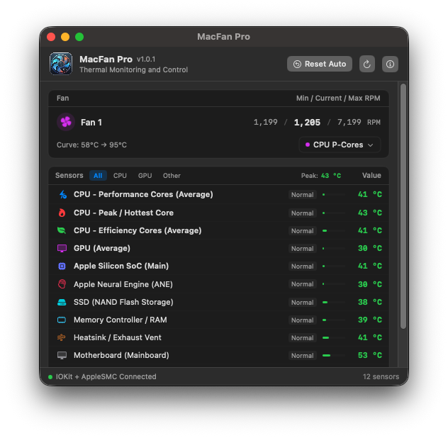

# MacFan Pro 🌀

**Professional fan control and real-time thermal monitoring for your Mac.**

[-informational?style=for-the-badge)](https://github.com/c4rlosm4rtins/macfan-pro-app/releases/latest)

🇺🇸 **English** | 🇧🇷 / 🇵🇹 [**Português**](README.pt.md)

 

[**📥 Download Latest Version (v1.0.1)**](https://github.com/c4rlosm4rtins/macfan-pro-app/releases/latest) • [**✨ Features**](#-key-features) • [**🚀 How to Install**](#-how-to-install) • [**❓ FAQ**](#-frequently-asked-questions)

 

---

## 📖 About MacFan Pro

**MacFan Pro** is a native, ultra-lightweight application designed to monitor system temperatures and manage fan speeds on Apple computers.

Built 100% with native Apple technologies (**Swift, SwiftUI, and AppKit**), MacFan Pro uses virtually zero CPU and memory, delivering a smooth, silent, and seamlessly integrated macOS experience.

---

## ✨ Key Features

- **Custom Temperature Curves (Sensor-Based):**
  - Bind fan behavior directly to any specific thermal sensor (such as **CPU Performance Cores**, GPU, or SoC).
  - Define custom minimum and maximum temperature thresholds (e.g., **58°C to 95°C**): fans stay quiet below the lower threshold, ramp up smoothly as temperature rises, and reach maximum RPM at the upper limit.
- **Full Manual & Preset Fan Control:**
  - Continuous real-time fan speed (RPM) adjustment.
  - Quick presets: Minimum, 50%, 75%, and Maximum speed.
  - Instant return to macOS-managed **Automatic** control.
- **Comprehensive Thermal Monitoring:**
  - Live readings from multiple hardware sensors: CPU Cores, SoC, GPU, Heatsink, SSD Flash, Battery, PMU, and RAM.
  - Dynamic visual indicators by thermal zone (Normal, Moderate, Elevated, and Critical).
- **Menu Bar Integration:**
  - Monitor peak temperatures and current fan speeds directly from the macOS top menu bar without keeping any windows open (`1200 RPM  48°C`).
- **Native & Silent Design:**
  - Closing the main window keeps the app running silently in the background via the Menu Bar.
  - Full support for macOS Light and Dark modes.
- **Universal Binary:**
  - 100% native execution on both **Apple Silicon (M1–M6)** and **Intel** processors.

---

## 📥 How to Install

1. Go to the [**Official Releases**](https://github.com/c4rlosm4rtins/macfan-pro-app/releases/latest) page and download **`MacFanPro.pkg`**.
2. Double-click the downloaded file (or right-click and select **Open**).
3. Follow the native Apple installer assistant. The app will be installed in `/Applications` and hardware permissions will be configured automatically.

---

## 🔒 macOS Security Notice (Gatekeeper)

Because MacFan Pro is independent software distributed outside the Mac App Store, macOS may display a security warning the first time you open it:

> [!TIP]
> If macOS displays *"MacFan Pro cannot be opened because Apple cannot check it for malicious software"*:
> 1. Open **System Settings** > **Privacy & Security**.
> 2. Scroll down to the **Security** section.
> 3. Click **"Open Anyway"** next to the MacFan Pro notice.
>
> *Quick alternative: right-click (`Control + Click`) the installer and select **Open**.*

---

## ⚙️ System Requirements

- **Operating System:** macOS 13.0 (Ventura) or later.
- **Supported Hardware:**
  - **Apple Silicon:** MacBook Pro, Mac mini, iMac, Mac Studio, Mac Pro (M1–M6 and Pro/Max/Ultra variants). *(Note: **MacBook Air** models with Apple Silicon do not have physical fans; on these Macs, the app operates strictly as a thermal monitor).*
  - **Intel:** Any 64-bit Intel Mac compatible with macOS 13+.

---

## ❓ Frequently Asked Questions

**Is it safe to manually adjust fan speeds or set temperature curves?**
Yes. MacFan Pro respects the safe minimum and maximum RPM limits defined by Apple's firmware (SMC). You can also switch back to **Automatic** mode with a single click at any time.

**Does the main window need to stay open for the app to work?**
No. You can close the main window (`⌘W`) and MacFan Pro will continue maintaining your active fan curve or speed profile and displaying live metrics in the Menu Bar.

---

## 📄 License & Terms of Use

**MacFan Pro** is free for personal and commercial use (*Proprietary Freeware*). All intellectual property and source code rights belong to **Carlos Martins**.

Copyright © 2026 Carlos Martins. All rights reserved.
