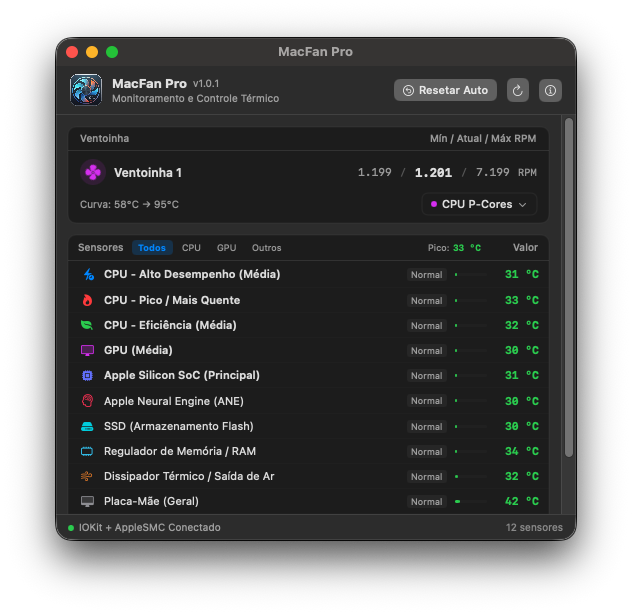

# MacFan Pro 🌀

**Controle profissional de ventoinhas e monitoramento térmico em tempo real para o seu Mac.**

[-informational?style=for-the-badge)](https://github.com/c4rlosm4rtins/macfan-pro-app/releases/latest)

🇺🇸 [**English**](README.md) | 🇧🇷 / 🇵🇹 **Português**

 

[**📥 Baixar Versão Mais Recente (v1.0.1)**](https://github.com/c4rlosm4rtins/macfan-pro-app/releases/latest) • [**✨ Funcionalidades**](#-funcionalidades-principais) • [**🚀 Como Instalar**](#-como-instalar) • [**❓ Perguntas Frequentes**](#-perguntas-frequentes)

 

---

## 📖 Sobre o MacFan Pro

O **MacFan Pro** é um aplicativo nativo e ultraleve criado para monitorar as temperaturas do sistema e gerenciar a rotação das ventoinhas de computadores Apple.

Construído 100% com tecnologias nativas da Apple (**Swift, SwiftUI e AppKit**), o MacFan Pro consome praticamente zero de processamento e memória, oferecendo uma experiência fluida, silenciosa e totalmente integrada ao macOS.

---

## ✨ Funcionalidades Principais

- **Curvas de Temperatura Personalizadas (Baseadas em Sensores):**
  - Vincule a rotação das ventoinhas a um sensor específico (como os **Núcleos de Desempenho da CPU**, GPU ou SoC).
  - Defina limites personalizados de temperatura mínima e máxima (por exemplo, **58°C a 95°C**): as ventoinhas permanecem silenciosas abaixo do limite inicial, aceleram progressivamente conforme a temperatura sobe e atingem a rotação máxima no limite superior.
- **Controle Manual e Presets Rápidos:**
  - Ajuste contínuo de rotação (RPM) em tempo real.
  - Presets rápidos: Mínimo, 50%, 75% e Velocidade Máxima.
  - Retorno instantâneo para o controle **Automático** gerenciado pelo macOS.
- **Monitoramento Térmico Abrangente:**
  - Leitura ao vivo de múltiplos sensores: CPU Cores, SoC, GPU, Heatsink, SSD Flash, Bateria, PMU e Memória RAM.
  - Indicadores visuais dinâmicos por faixa térmica (Normal, Moderado, Elevado e Crítico).
- **Integração com a Barra de Menus (Menu Bar):**
  - Acompanhe a temperatura de pico e a rotação atual diretamente na barra superior do macOS sem abrir janelas (`1200 RPM  48°C`).
- **Design Nativo e Silencioso:**
  - Ao fechar a janela principal, o app continua operando silenciosamente em segundo plano no Menu Bar.
  - Suporte completo aos modos Claro e Escuro do macOS.
- **Universal Binary:**
  - Execução 100% nativa tanto em chips **Apple Silicon (M1–M6)** quanto em processadores **Intel**.

---

## 📥 Como Instalar

1. Acesse a página de [**Releases Oficiais**](https://github.com/c4rlosm4rtins/macfan-pro-app/releases/latest) e baixe o arquivo **`MacFanPro.pkg`**.
2. Dê um duplo-clique no arquivo baixado (ou clique com o botão direito e selecione **Abrir**).
3. Siga o assistente de instalação nativo da Apple. O aplicativo será instalado em `/Applications` e as permissões de hardware serão configuradas automaticamente.

---

## 🔒 Aviso de Segurança do macOS (Gatekeeper)

Por ser um software independente distribuído diretamente fora da Mac App Store, o macOS pode exibir um alerta de segurança na primeira abertura:

> [!TIP]
> Se o sistema exibir o aviso *"MacFan Pro não pode ser aberto porque a Apple não pode verificar se há software malicioso"*:
> 1. Abra os **Ajustes do Sistema** (*System Settings*) > **Privacidade e Segurança** (*Privacy & Security*).
> 2. Role até a seção **Segurança**.
> 3. Clique em **"Abrir Mesmo Assim"** (*Open Anyway*) ao lado da notificação do MacFan Pro.
>
> *Alternativa rápida: clique com o botão direito (`Control + Clique`) sobre o instalador e selecione **Abrir**.*

---

## ⚙️ Requisitos do Sistema

- **Sistema Operacional:** macOS 13.0 (Ventura) ou superior.
- **Hardware Compatível:**
  - **Apple Silicon:** MacBook Pro, Mac mini, iMac, Mac Studio, Mac Pro (M1–M6 e variantes Pro/Max/Ultra). *(Nota: Modelos **MacBook Air** com Apple Silicon não possuem ventoinhas físicas; neles, o app funciona exclusivamente como monitor térmico).*
  - **Intel:** Todos os Macs com processador Intel de 64 bits compatíveis com macOS 13+.

---

## ❓ Perguntas Frequentes

**É seguro alterar a velocidade das ventoinhas ou criar curvas de temperatura?**
Sim. O MacFan Pro respeita os limites mínimos e máximos seguros definidos pelo firmware da Apple (SMC). Além disso, você pode retornar ao modo **Automático** com um clique a qualquer momento.

**O aplicativo precisa ficar com a janela aberta para funcionar?**
Não. Você pode fechar a janela principal (`⌘W`) e o MacFan Pro continuará mantendo a curva de temperatura ou o perfil de rotação escolhido e exibindo as métricas na Barra de Menus.

---

## 📄 Licença e Termos de Uso

O **MacFan Pro** é um software gratuito para uso pessoal e profissional (*Proprietary Freeware*). Todos os direitos intelectuais e de código pertencem a **Carlos Martins**.

Copyright © 2026 Carlos Martins. Todos os direitos reservados.